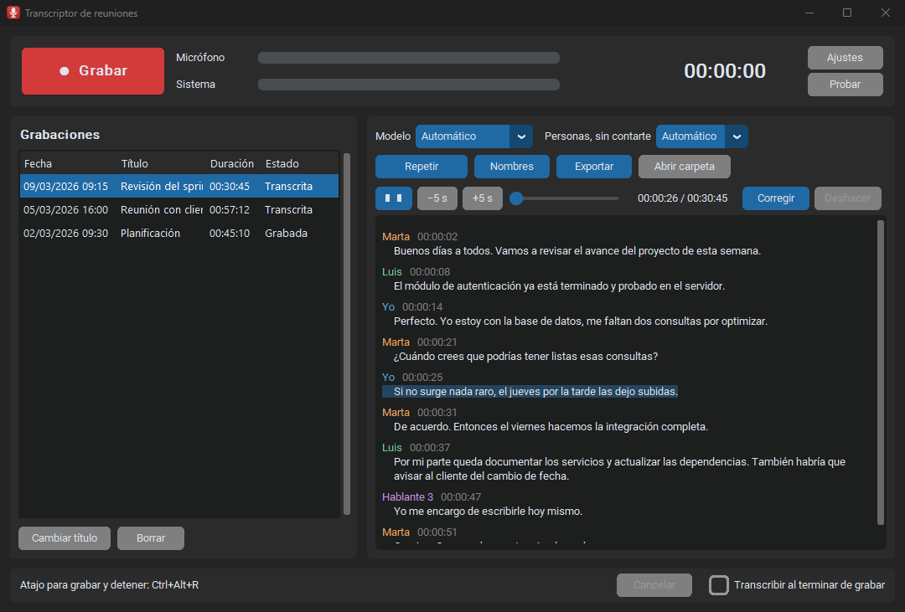
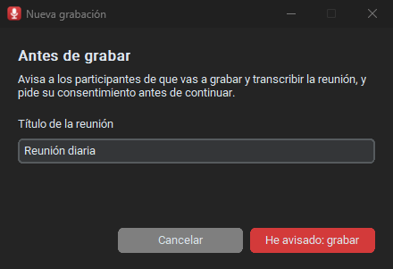
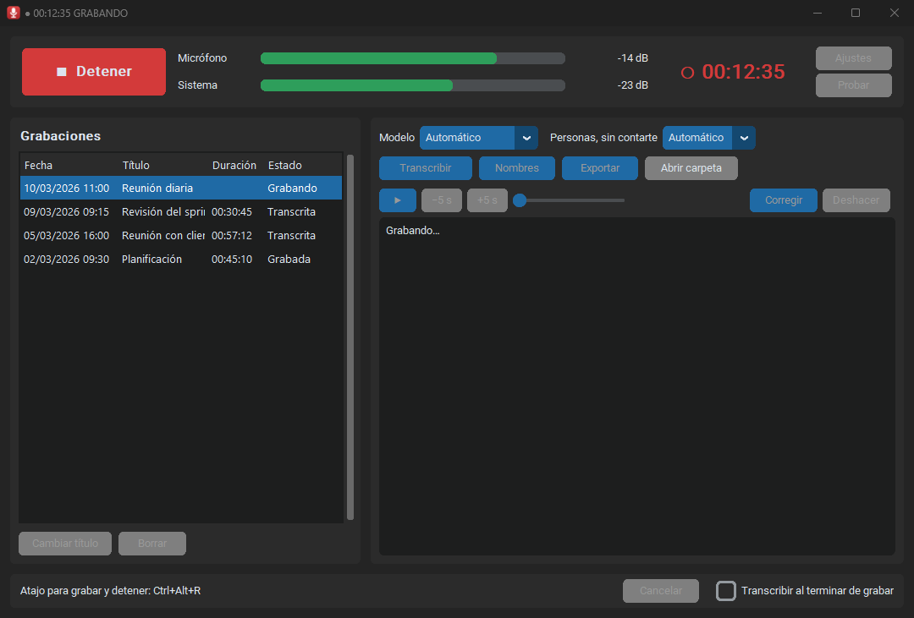
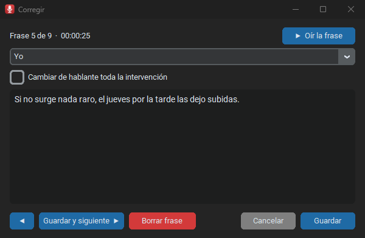
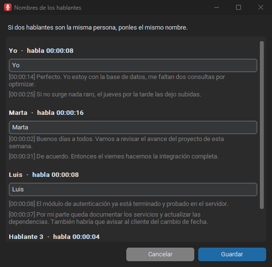

# Transcriptor de reuniones local: graba, transcribe y separa hablantes sin nube

[](https://www.python.org/)
[](https://www.microsoft.com/windows)
[](https://github.com/SYSTRAN/faster-whisper)
[](https://github.com/pyannote/pyannote-audio)
[](LICENSE)

Aplicación de escritorio para Windows que graba reuniones de Teams, Zoom, Meet o
cualquier otro programa, las transcribe en español y distingue quién habla. El
resultado se exporta a `.txt`, `.docx` y `.srt`.

**Todo ocurre en el equipo.** Ningún bot entra en la llamada y el audio no sale
del ordenador: solo se usa Internet para descargar los modelos, una vez.

La idea que lo articula es grabar **dos pistas separadas y sincronizadas**, el
micrófono por un lado y el sonido del equipo por otro. Así se sabe con certeza
qué dijo quien graba, y el reconocimiento de voces solo tiene que resolver al
resto de participantes.



---

## Tabla de contenido

- [Antes de grabar: consentimiento](#antes-de-grabar-consentimiento)
- [Puesta en marcha](#puesta-en-marcha)
- [Uso de la aplicación](#uso-de-la-aplicación)
- [Qué archivos genera](#qué-archivos-genera)
- [Consola y configuración](#consola-y-configuración)
- [GPU y ejecutable](#gpu-y-ejecutable)
- [Solución de problemas](#solución-de-problemas)
- [Cómo funciona](#cómo-funciona)
- [Rendimiento medido](#rendimiento-medido)
- [Pruebas](#pruebas)
- [Estructura del repositorio](#estructura-del-repositorio)
- [Decisiones técnicas](#decisiones-técnicas)
- [Limitaciones conocidas](#limitaciones-conocidas)
- [Autor](#autor)

---

## Antes de grabar: consentimiento

Grabar una conversación sin avisar puede ser ilegal según el país. La aplicación
muestra un recordatorio antes de cada grabación, pero la responsabilidad de
informar a los participantes y obtener su permiso es de quien graba.

Las grabaciones y las transcripciones se guardan **sin cifrar**. Conviene
tenerlas en un disco protegido, por ejemplo con BitLocker.

---

## Puesta en marcha

**Requisitos:** Windows 11, [Python 3.12](https://www.python.org/downloads/),
[Git](https://git-scm.com/) y una cuenta gratuita de
[Hugging Face](https://huggingface.co/join). Todos los comandos son de
PowerShell.

### 1. Instalar

```powershell
git clone https://github.com/jhosuechica/transcriptor-reuniones.git
```

```powershell
cd transcriptor-reuniones
```

Se crea un entorno aislado para no mezclar las librerías con las del sistema:

```powershell
py -3.12 -m venv .venv
```

La instalación descarga las librerías, entre ellas PyTorch, y tarda unos
minutos:

```powershell
.\.venv\Scripts\python.exe -m pip install -r requirements.txt
```

### 2. Descargar un modelo de transcripción

`small` es el más rápido y sirve para empezar en cualquier equipo:

```powershell
.\.venv\Scripts\python.exe cli.py descargar small
```

Con una GPU compatible, `large-v3` da la mejor calidad y ocupa unos 3 GB. También hay `medium` y `large-v3-turbo`:

```powershell
.\.venv\Scripts\python.exe cli.py descargar large-v3
```

### 3. Descargar el modelo que separa las voces

Este modelo es gratuito, pero exige aceptar sus condiciones:

1. Entra en Hugging Face y acepta las condiciones de
   [speaker-diarization-community-1](https://huggingface.co/pyannote/speaker-diarization-community-1).
2. En [Settings, Access Tokens](https://huggingface.co/settings/tokens), crea un
   token de tipo **Read**.
3. Ejecuta el comando y pega el token cuando lo pida. No se muestra en pantalla:

```powershell
.\.venv\Scripts\python.exe cli.py descargar diarizacion
```

El token solo se usa en esa descarga y no se guarda. Después se puede borrar en
Hugging Face.

### 4. Abrir la aplicación

Con doble clic en `Transcriptor.bat`, o desde la consola:

```powershell
.\Transcriptor.bat
```

En **Ajustes**, elige el micrófono y la salida por la que suena la reunión. Si
se dejan en «Predeterminado de Windows» se usan los del sistema.

---

## Uso de la aplicación

### Grabar

Antes de una reunión importante conviene pulsar **Probar**: escucha el micrófono
y la salida unos segundos, sin guardar nada, y dice si el nivel es correcto.

1. Pulsa **Grabar** o `Ctrl+Alt+R`. El atajo funciona aunque la ventana esté
   minimizada.
2. Escribe un título y confirma que los participantes están avisados.
3. Comprueba que los dos medidores se mueven. Si una pista lleva diez segundos
   en silencio, aparece «Sin señal».
4. Pulsa **Detener** o repite el atajo.



Mientras se graba, un indicador rojo permanece sobre las demás ventanas. Se
puede arrastrar, y con doble clic abre la aplicación. Si se comparte la pantalla
completa, los demás lo ven; se desactiva en Ajustes.



Conviene usar **auriculares**: con altavoces, el micrófono capta también a los
demás. Las notificaciones y la música del equipo quedan grabadas.

### Transcribir

1. Elige la grabación en la lista.
2. Si se conoce, indica cuántas personas hablan **sin contar a quien graba**.
   Ayuda a separar las voces.
3. Pulsa **Transcribir**. Se puede cancelar y el audio se conserva. Con
   **Transcribir al terminar de grabar**, el proceso empieza solo.

Si hay otra en curso o se está grabando, la reunión queda **en cola**. Abajo se
estima lo que falta de cada paso, y al terminar avisa en la barra de tareas.

Para repetir con otro número de personas, pulsa **Repetir** y responde «No»: se
separan de nuevo las voces sin volver a transcribir.

### Escuchar y corregir

Con **doble clic** en una frase se oye la reunión desde ese momento, con las dos
pistas mezcladas y la frase en curso resaltada. Un clic solo la selecciona.

**Corregir** abre la frase elegida para cambiar el texto o la persona, y permite
avanzar por las siguientes oyendo cada una. Con el botón derecho se puede además
reasignar o borrar una frase.



| Tecla, sobre el texto | Acción |
|---|---|
| Espacio | Escuchar o pausar |
| Flechas izquierda y derecha | Retroceder o avanzar 5 segundos |
| F2 | Corregir la frase |
| Ctrl+Z | Deshacer |
| Ctrl+Intro, en el diálogo | Guardar y pasar a la siguiente |

Cada corrección se guarda al momento y los archivos exportados se actualizan a
los pocos segundos. **Repetir** la transcripción no conserva las correcciones,
pero guarda antes una copia del documento corregido.

### Ordenar las grabaciones

**Cambiar título** (F2) renombra también la carpeta y los archivos exportados.
**Borrar** (Supr) la mueve a la papelera. No se puede mientras está en uso.

### Poner nombres y exportar

El botón **Nombres** muestra cuánto habla cada persona y dos frases suyas, para
reconocerla. Al guardar, el nombre cambia en los tres archivos. Si la aplicación
dividió a una persona en dos, basta con poner el mismo nombre a ambas.



Los archivos se crean al transcribir y **Exportar** los regenera. Si alguno se
editó a mano, esa versión se conserva como `transcripcion (editado fecha)`.

---

## Qué archivos genera

Cada reunión tiene su carpeta en `Documents\Reuniones`, con el audio de las dos
pistas, la transcripción en tres formatos y los datos intermedios, detallados en
[docs/CONSOLA-Y-CONFIGURACION.md](docs/CONSOLA-Y-CONFIGURACION.md#archivos-de-una-reunión).

El texto sigue este formato:

```
[00:00:08] Luis: El módulo de autenticación ya está terminado.
[00:00:14] Yo: Perfecto. Yo estoy con la base de datos.
```

---

## Consola y configuración

Todo lo que hace la ventana se puede hacer también por comandos. La lista, junto
con las claves de `config.json`, está en
[docs/CONSOLA-Y-CONFIGURACION.md](docs/CONSOLA-Y-CONFIGURACION.md).

---

## GPU y ejecutable

Sin GPU la aplicación funciona igual, solo que más despacio y con un modelo
menor. Para usar una tarjeta AMD o NVIDIA, o para crear un `.exe` que funcione
sin Python, se siguen los pasos de
[docs/GPU-Y-EJECUTABLE.md](docs/GPU-Y-EJECUTABLE.md).

---

## Solución de problemas

| Síntoma | Qué hacer |
|---|---|
| Graba otro micrófono | Elegirlo en Ajustes; `cli.py dispositivos` los lista |
| La pista del sistema sale vacía | La reunión sonaba por otra salida: elegirla en Ajustes |
| El sonido distorsiona o casi no se oye | Pulsar **Probar** y seguir el consejo |
| No se encuentra ningún micrófono | Revisar Privacidad y seguridad, Micrófono, en Windows |
| El atajo está ocupado | Otro programa lo usa; se cambia en Ajustes |
| Mis frases aparecen repetidas | Los altavoces entran por el micrófono: usar auriculares |
| Confunde a las personas | Indicar cuántas hay y pulsar **Repetir** |
| No se puede exportar el `.docx` | Está abierto en Word: cerrarlo y exportar de nuevo |
| Falla la GPU | La aplicación pasa sola a la CPU; el motivo queda en el registro |

El registro está en `logs\app.log`, o en
`%LOCALAPPDATA%\TranscriptorReuniones\logs` si se usa el ejecutable.

---

## Cómo funciona

```
micrófono ──► mic.wav ──────► transcripción ──────────────────────┐
                                                                  ├─► unión ─► exportación
sistema ────► sistema.wav ──► transcripción + separación de voces ┘
```

1. **Grabación.** WASAPI captura el micrófono y, en modo *loopback*, lo que suena
   por los altavoces. Un reloj común coloca cada bloque en su instante: se
   rellenan los huecos y se corrige la deriva entre dispositivos.
2. **Transcripción.** faster-whisper procesa cada pista en un proceso aparte,
   con el español fijado y marcas de tiempo por palabra.
3. **Separación de voces.** pyannote analiza solo la pista del sistema, en CPU y
   con su telemetría desactivada.
4. **Unión.** Cada palabra recibe un hablante, se agrupan en frases y se ordenan
   las dos pistas. Se descartan las frases del micrófono que repiten lo que dijo
   otra persona.

---

## Rendimiento medido

Equipo: Ryzen 7 5700X, 32 GB de RAM y RX 7600 XT de 16 GB, con Windows 11.

| Medida | Resultado |
|---|---|
| `large-v3` en GPU (`int8_float16`, lotes de 8) | 1084 s de audio en 191,7 s: 5,7 veces el tiempo real |
| `small` en CPU (`int8`) | 3,6 veces el tiempo real |
| Separación de voces en CPU | 1084 s de audio en 154 s: 7 veces el tiempo real |
| Palabras bien atribuidas | 136 de 144 (94,4 %) |

Los audios de prueba son **voces sintéticas y limpias**. La atribución se midió
en un diálogo de 54 segundos con tres voces, sin indicar cuántas había,
comparando el hablante de cada palabra con el guion. Una reunión real, con ruido
y personas que se pisan, dará peores resultados.

Durante la separación de voces y durante el proceso completo del ejecutable se
vigilaron las conexiones de red y no se detectó ninguna.

---

## Pruebas

```powershell
.\.venv\Scripts\python.exe -m unittest discover -s tests
```

Son 191 y no necesitan modelos, micrófono ni GPU. Cubren la alineación de las
pistas, los reintentos, la asignación de hablantes, los archivos exportados, el
reproductor y la ventana, que se abre de verdad con el audio simulado. Durante
unos segundos aparecen ventanas en pantalla.

La calidad de la transcripción no se prueba de forma automática.

---

## Estructura del repositorio

```
.
├── gui.py                  Ventana; las reglas de hilos están al principio
├── visor.py                Panel para leer, escuchar y corregir
├── componentes.py          Base común de los diálogos
├── cli.py                  Los mismos pasos por consola
├── flujo.py                Lo que comparten ambas: listar y procesar
├── recorder.py             Las dos pistas y su sincronización
├── transcriber.py          Whisper, con una escalera de intentos GPU y CPU
├── diarizer.py             Separación de voces
├── merger.py               Une las pistas y gestiona los nombres
├── exporter.py             Archivos finales, sin perder ediciones a mano
├── reproductor.py          Suena en el hilo de audio, con las pistas mezcladas
├── proceso.py              Ejecuta el trabajo pesado en otro proceso
├── windows.py              Atajo global, instancia única y suspensión
├── config.py               Configuración, rutas y registro
├── construir.py            Genera el ejecutable con un PATH limpio
├── transcriptor.spec       Qué entra en el ejecutable y qué no
├── Transcriptor.bat        Abre la aplicación sin consola
├── requirements*.txt       Versiones fijadas: base, GPU AMD y ejecutable
├── recursos/               Icono
├── tests/                  Una suite por módulo principal
└── docs/
    ├── CONSOLA-Y-CONFIGURACION.md Comandos y claves
    ├── GPU-Y-EJECUTABLE.md Pasos opcionales, fuera del README por extensión
    ├── adr/                Decisiones de diseño
    └── img/                Capturas, con datos inventados
```

---

## Decisiones técnicas

- [ADR-0001 · Grabar dos pistas separadas](docs/adr/0001-dos-pistas-separadas.md)
- [ADR-0002 · Ejecutar los modelos en un proceso aparte](docs/adr/0002-modelos-en-proceso-aparte.md)
- [ADR-0003 · Usar int8_float16 en la GPU](docs/adr/0003-int8-float16-en-gpu.md)
- [ADR-0004 · Generar los archivos desde un documento único](docs/adr/0004-documento-unico.md)
- [ADR-0005 · Recoger la memoria solo en el hilo de la ventana](docs/adr/0005-recoleccion-de-memoria.md)

El primero es el que define el proyecto: separar las pistas resuelve sin modelos
la mitad del problema de saber quién habla, a cambio de tener que sincronizar
dos relojes de audio distintos. El tercero explica un fallo que no daba error:
la GPU devolvía texto corrupto y el proceso terminaba con normalidad.

---

## Limitaciones conocidas

- **Solo funciona en Windows.** La captura usa WASAPI y el atajo, la API de
  Windows. Se ha probado únicamente en Windows 11 con Python 3.12.
- **La separación de voces no se ha validado con reuniones reales.** Las cifras
  proceden de voces sintéticas; con varias personas reales el acierto se
  desconoce.
- **Las intervenciones muy cortas se atribuyen mal.** En la prueba, el «Sí» de
  una persona quedó asignado a otra.
- **Nadie puede compartir el micrófono.** Todo lo que entra por él se atribuye a
  quien graba.
- **El español está fijado.** Las partes en otro idioma saldrán mal.
- **Se graba todo lo que suena en el equipo.** Incluye notificaciones y música;
  no se aísla una aplicación concreta.
- **La GPU se aprovecha a medias.** No acelera la separación de voces, y en la
  transcripción se usa un cálculo más lento por el fallo del ADR-0003.
- **Las correcciones no sobreviven a una nueva transcripción.** Se guarda una
  copia, pero no hay forma de aplicarlas al documento nuevo ni de restaurarla
  desde la ventana.
- **No se puede escuchar mientras se graba.** Lo que sonara quedaría en la
  grabación.
- **Los subtítulos largos tienen tiempos aproximados.** Al dividir una frase, el
  tiempo se reparte según la longitud del texto.
- **El audio ocupa unos 0,7 GB por hora.** No se comprime ni se borra solo; si el
  disco está casi lleno, la grabación se detiene y se guarda.
- **No hay integración continua ni ejecutable publicado.** Las pruebas se
  ejecutan en local y el `.exe` hay que construirlo.
- **La licencia MIT cubre solo este código.** Los modelos y las librerías no se
  redistribuyen y tienen las suyas.

---

## Autor

**Jhosué Chica**, Desarrollador de Software
[LinkedIn](https://www.linkedin.com/in/jhosue-chica-0811a933a) · [GitHub](https://github.com/jhosuechica)
